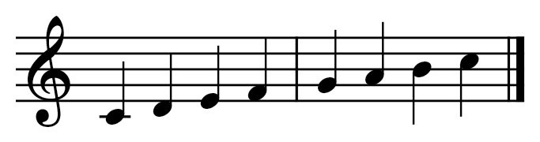

# LunarScore: Kotlin Multiplatform sheet music renderer

A small Kotlin Multiplatform library that renders conventional music notation with Compose
Multiplatform and the [Bravura](https://github.com/steinbergmedia/bravura) SMuFL font.



**Milestone 1 (current):** a single treble-clef staff with whole, half and quarter notes, stems,
ledger lines, barlines and a final barline. A separate MusicXML importer now reads partwise headers,
measures and a single voice of notes and rests with exact timing; chords, multiple voices/staves,
playback, editing, beaming and system breaking remain future work. See the
[importer scope](docs/musicxml/partwise-import.md), [note/rest scope](docs/musicxml/note-import.md) and
[attribute state](docs/musicxml/attribute-state.md).

## Modules

| Module | Contents | Targets |
|---|---|---|
| `sheetmusic-model` | Format-neutral score hierarchy, exact rational time, written/sounding pitch, notation and relationships. No XML or Compose dependency. See the [model contract](docs/musicxml/model.md). | Android, JVM, iosArm64, iosSimulatorArm64, JS (browser, Node.js), Wasm (browser, Node.js) |
| `sheetmusic-core` | Score model (`Score`, `Measure`, `Note`, …), SMuFL glyph metrics and the layout engine. Pure Kotlin with no Compose dependency. | Android, JVM, iosArm64, iosSimulatorArm64, JS (browser, Node.js), Wasm (browser, Node.js) |
| `sheetmusic-compose` | The `SheetMusic` composable. It bundles the Bravura font. | Android, JVM, iosArm64, iosSimulatorArm64, JS (browser), Wasm (browser) |
| `sample` | The example score as a desktop app and as a web page (JS and Wasm), with one shared screen | JVM desktop, JS, Wasm |
| `musicxml-parser` | Public partwise score importer with metadata, single-voice notes/rests, key/time/clef state, ID/reference diagnostics and provenance; bounded `.mxl` archive import ([details](docs/musicxml/mxl-import.md)); secure XML reader and XML/ZIP probes. See [importer scope](docs/musicxml/partwise-import.md) and [diagnostic contract](docs/musicxml/diagnostics.md). | Android, JVM, iosArm64, iosSimulatorArm64 |

## Using it from another KMP project

Coordinates: `com.ryanjames.sheetmusic:sheetmusic-compose:0.1.0-SNAPSHOT`. This module depends on
`sheetmusic-core` through `api`, so the model classes come with it.

The library is not on a public repository yet. To consume it locally, publish it to Maven Local:

```bash
./gradlew publishToMavenLocal
```

Then, in the consuming project:

```kotlin
// settings.gradle.kts
dependencyResolutionManagement {
    repositories {
        mavenLocal()
        google()
        mavenCentral()
    }
}

// shared/build.gradle.kts
kotlin {
    sourceSets {
        commonMain.dependencies {
            implementation("com.ryanjames.sheetmusic:sheetmusic-compose:0.1.0-SNAPSHOT")
        }
    }
}
```

The consumer must be a Compose Multiplatform project (Kotlin Compose compiler plugin and
`org.jetbrains.compose` plugin applied), just like any project that uses Compose. You don't need to set
up any fonts or glyphs: Bravura ships inside the library as a Compose resource. It is packaged as
Android assets in the AAR, as classpath resources in the JVM jar, inside the JS/Wasm klibs, and for iOS
through the Compose resources mechanism. A web app's build copies the font into its distribution
under `composeResources/`, and the browser fetches it from there at runtime. It is served by your own
web server and never comes from a third-party network.

If you only need the model and layout (for example, to write a different renderer), depend on
`com.ryanjames.sheetmusic:sheetmusic-core:0.1.0-SNAPSHOT` instead.

## Usage

```kotlin
val score = Score(
    measures = listOf(
        Measure(
            notes = listOf(
                Note(Pitch.C, 4, Duration.QUARTER),
                Note(Pitch.D, 4, Duration.QUARTER),
                Note(Pitch.E, 4, Duration.QUARTER),
                Note(Pitch.F, 4, Duration.QUARTER),
            )
        ),
        Measure(
            notes = listOf(
                Note(Pitch.G, 4, Duration.QUARTER),
                Note(Pitch.A, 4, Duration.QUARTER),
                Note(Pitch.B, 4, Duration.QUARTER),
                Note(Pitch.C, 5, Duration.QUARTER),
            )
        ),
    )
)

SheetMusic(
    score = score,
    modifier = Modifier.fillMaxWidth(),
    staffSpace = 10.dp,   // optional: distance between staff lines; everything scales with it
    color = Color.Black,  // optional
)
```

- The octave uses scientific pitch notation, so `Note(Pitch.C, 4, …)` is middle C.
- `SheetMusic` sizes its own height from the content. Its width is the score's natural width, or it
  stretches note spacing to fill a minimum width set by the modifier (for example
  `fillMaxWidth()`). Content wider than the available space is clipped, because system breaking is
  not implemented yet.
- On the web the font loads asynchronously. Until it arrives, `SheetMusic` reserves its full size but
  draws nothing, so you never see glyphs in a fallback font or a layout jump. On every other platform
  the font is ready on the first frame.

### Public API

- `com.ryanjames.sheetmusic.model`: `Score`, `Measure`, `Note`, `Pitch`, `Duration`, `Clef`
- `com.ryanjames.sheetmusic.score`: the richer neutral model in `sheetmusic-model`.
  `com.ryanjames.sheetmusic.model.Score.toNeutralScore()` lifts the existing renderer model into it;
  the layout and Compose entry points continue to accept the existing renderer model.
- `com.ryanjames.sheetmusic.compose`: `SheetMusic`
- `com.ryanjames.sheetmusic.layout`: `layoutScore(score, minWidth, settings)` returns a `ScoreLayout`.
  This contains every staff line, glyph, stem, ledger line and barline, positioned in staff spaces.
  It is the contract between layout and rendering.
- `com.ryanjames.sheetmusic.smufl`: `SmuflGlyph` and `BravuraMetrics` (bounding boxes, stem anchors and
  engraving defaults)

The generated Compose resource accessor (`Res`) and the drawing code are internal.

## How rendering works

1. **Model.** `Score` is plain Kotlin data with no UI types.
2. **Layout** (`sheetmusic-core`). This step turns the score into positioned elements, measured in
   staff spaces with y pointing down:
   - The staff position is the number of diatonic steps above the bottom line, relative to the clef.
     For treble clef, E4 = 0, G4 = 2 and F5 = 8. The y coordinate is `top + (8 − position) / 2`.
   - Glyph placement uses the SMuFL metadata, copied from `Bravura.json` of Bravura 1.482. This
     includes glyph bounding boxes, the `stemUpSE` and `stemDownNW` anchors, and the engraving
     defaults (line thicknesses, ledger extension, barline separation).
   - Stems point down from the middle line upward and up below it. Each stem is one octave (3.5
     spaces) long and always reaches the middle line. Its edge sits on the notehead's stem anchor.
   - Ledger lines go on every even position beyond the staff and extend `legerLineExtension` past the
     notehead. Barlines cover the full thickness of the outer staff lines.
   - Spacing is uniform per note. The whole layout is translated so that its content bounds plus
     padding start at (0, 0).
3. **Rendering** (`sheetmusic-compose`). Each staff space is multiplied by the pixel size of
   `staffSpace`. The renderer draws lines with `drawLine` using butt caps. It draws glyphs as text with
   a font size of 4 staff spaces, because a SMuFL em equals the height of the staff. Each glyph's SMuFL
   origin sits on the text baseline, so the text is drawn at `origin.y − firstBaseline`. That puts the
   baseline exactly on the layout position, whatever the font's ascent and line height are.

The model, the layout and all drawing code are shared by every platform. The only platform-specific
code is the font loading in `rememberBravuraFontFamily()`. In `nonWebMain` (Android, JVM, iOS), it
calls `Font(Res.font.bravura)`, which loads synchronously. In `webMain` (JS, Wasm), it calls
`preloadFont(Res.font.bravura)` and returns `null` until the font has been fetched.

## Building

Prerequisites:

- **JDK 17 or newer** to run Gradle. The project is built and tested with JDK 21. The Gradle wrapper
  (9.5.0) is included.
- **Android SDK with platform 37.** Compose Multiplatform 1.12 requires `compileSdk` 37. Set
  `sdk.dir` in `local.properties` or `ANDROID_HOME`. Android Studio does this for you.
- **iOS:** the iOS klibs cross-compile on Windows, Linux and macOS. Linking an iOS app or framework
  that uses the library, or running tests on an iOS simulator, needs macOS with Xcode.
- **Web:** Gradle downloads Node.js and Yarn automatically. The `sheetmusic-compose` browser tests
  run in **headless Chrome** through Karma, so Chrome must be installed (or `CHROME_BIN` set). The npm
  lock files in `kotlin-js-store/` belong in version control. After a dependency change, refresh them
  with `./gradlew kotlinUpgradeYarnLock kotlinWasmUpgradeYarnLock`.

Toolchain: Kotlin 2.4.21, Compose Multiplatform 1.12.1 and Android Gradle Plugin 9.3.3, which uses the
`com.android.kotlin.multiplatform.library` plugin. The versions are in `gradle/libs.versions.toml`.

```bash
./gradlew build
```

`./gradlew build` compiles every module and runs all tests on every target this host supports.

Run the sample on the desktop:

```bash
./gradlew :sample:run
```

Run it in a browser (Wasm or JS). Each command starts a dev server and opens the page:

```bash
./gradlew :sample:wasmJsBrowserDevelopmentRun
```

```bash
./gradlew :sample:jsBrowserDevelopmentRun
```

`./gradlew :sample:wasmJsBrowserDistribution` (or `jsBrowserDistribution`) builds a static site in
`sample/build/dist/<target>/productionExecutable/` that any static web server can host.

Run the tests on every target:

```bash
./gradlew allTests
```

The JVM rendering test writes PNGs to `sheetmusic-compose/build/render/` so you can inspect them.

### Tests

- `sheetmusic-core` runs on the JVM, as Android host tests, and on JS and Wasm in Node.js. The suites
  are:
  - `StaffPositionTest`: pitch to staff position, octave boundaries and the stem direction rule.
  - `ScoreLayoutTest`:
    - staff line count, spacing and thickness
    - clef placement
    - notehead positions and stems against the SMuFL anchors
    - stems that extend to the middle line, and whole notes without stems
    - ledger lines and barline placement and types
    - content inside the padded bounds
    - no overlap between the clef, notes and barlines
    - justification and spacing
- `sheetmusic-compose` runs `SheetMusicRenderTest`, a single common test, on the JVM and in headless
  Chrome for both JS and Wasm. It renders with the real bundled font, which on the web means fetching
  it the way an app does. It checks that the image size matches the layout, that noteheads are inked
  at their centres, and that notehead and clef ink edges match the SMuFL bounding boxes within 1.5 px.
  It also checks that rendering at a staff space of 20 px is a 2× scale of 10 px. The test also
  compiles for iOS; running it there needs macOS.
  - Two test-only adaptations exist. On Kotlin/JS, `runRenderTest` waits for Skia's WebAssembly module
    before it creates the scene. `karma.config.d/` serves the Compose resources and raises Mocha's
    2 s timeout.

## Font licence

Bravura is © Steinberg Media Technologies GmbH and licensed under the SIL Open Font License 1.1. The
licence is distributed with the font in the library's resources:
[`sheetmusic-compose/src/commonMain/composeResources/files/BRAVURA-OFL.txt`](sheetmusic-compose/src/commonMain/composeResources/files/BRAVURA-OFL.txt).
The font file itself is unmodified (`font/bravura.otf`, version 1.482).
